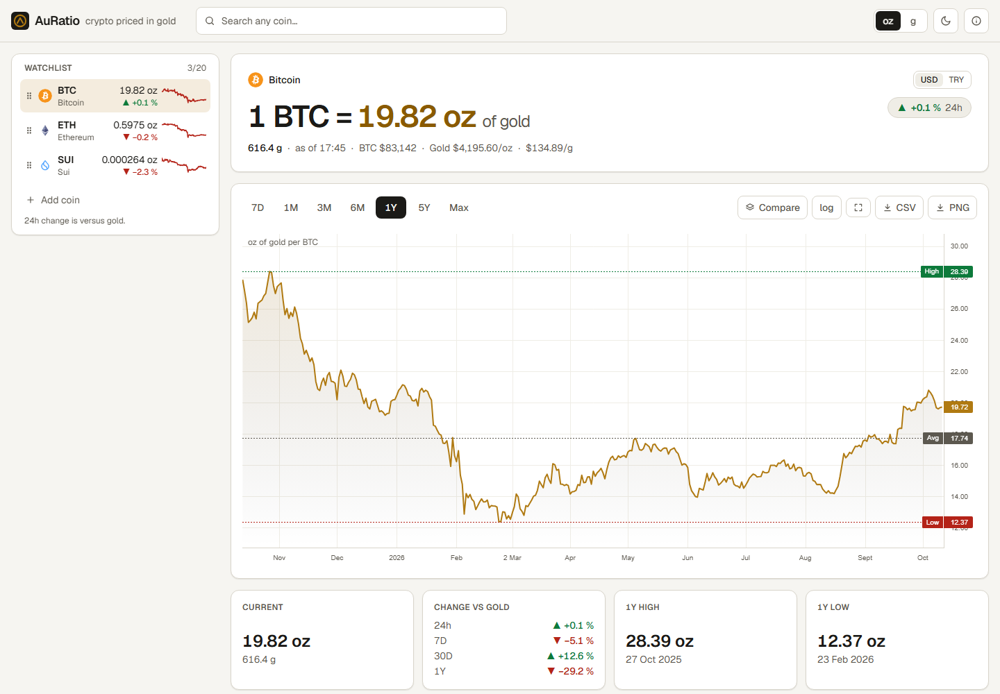

# AuRatio — crypto priced in gold

**Live at [www.cryptogold.me](https://www.cryptogold.me)**

AuRatio answers one question: **how much gold is one unit of a cryptocurrency worth, and how has that changed?**
Pick any coin and it shows the live coin/gold ratio in troy ounces or grams, a chart of how it moved, key figures
and a plain-language summary of what the chart says.

Live coin prices come from [FreeCryptoAPI](https://freecryptoapi.com). Its free plan has no history, so **AuRatio
records the prices itself**: every minute while the server runs, it saves each followed coin's price and the gold
price into a local SQLite file, and the charts are drawn from that recording.



- Live ratio for any coin, in **oz or g** (one toggle, no refetch), refreshed every 60 s while the tab is visible
- Chart of the recorded history with **7D / 1M / 3M / 6M / 1Y / 5Y / Max**, crosshair tooltip, high/low/average lines, log scale, pan and zoom
- **Plain-language summary** from deterministic templates (no AI service)
- **Watchlist** (default BTC, ETH, SUI; up to 20, reorderable) with sparklines, plus search across all CoinGecko coins
- **Compare** up to 4 coins indexed to 100
- Prices in USD or **TRY** (prices only; ratios never change), CSV/PNG export, shareable URLs, light/dark theme
- Stale, fallback, rate-limit, offline and "recording paused" states are shown, never a blank page

## Quick start

Requires Node.js 22.13 or newer for the built-in SQLite module (developed on Node 26).

```bash
npm install
cp .env.example .env.local   # then fill in FREECRYPTOAPI_KEY
npm run dev                  # http://localhost:3000 (or: npm run build && npm start)
```

Recording starts as soon as the server starts: the server log shows
`[auratio] recording prices every 60 s to …/data/auratio.db`. A new coin's chart appears after a few minutes
(per-minute points at first, hourly once a few hours are recorded). **Keep the server running to keep recording**;
time with the server off shows as a gap in the chart.

| Variable                     | Required | Purpose                                                                                                                                                          |
| ---------------------------- | -------- | ---------------------------------------------------------------------------------------------------------------------------------------------------------------- |
| `FREECRYPTOAPI_KEY`          | yes      | Live coin prices from FreeCryptoAPI. The server prints a readable error at startup if it is missing.                                                             |
| `COINGECKO_DEMO_API_KEY`     | no       | A [CoinGecko Demo key](https://www.coingecko.com/en/developers/dashboard) raises CoinGecko rate limits (search, names, 24h change). Keyless is used otherwise.   |
| `AURATIO_DB_PATH`            | no       | Where recorded history is stored. Default `data/auratio.db` (git-ignored). Back this file up to keep your history.                                               |
| `RECORDER`                   | no       | `on` (default) or `off`. With `off` the dashboard still works, but nothing new is recorded.                                                                      |
| `RECORD_INTERVAL_SECONDS`    | no       | Default 60, minimum 60. One FreeCryptoAPI request per interval: 60 s ≈ 44,000 of the free plan's 100,000 requests a month.                                       |
| `FREECRYPTOAPI_DAILY_BUDGET` | no       | Most FreeCryptoAPI requests per UTC day (default 3,200, about 97,000 a month). Past it, live prices come from CoinGecko and recording pauses until the next day. |
| `PUBLIC_HOST`                | no       | Public address, e.g. `www.cryptogold.me`; the bare domain then redirects to it. Read at build time, so run `npm run build` after changing it.                    |
| `BINANCE_BASE_URL`           | no       | Last-resort PAXG gold price. Defaults to `https://api.binance.com` (falls back to `https://data-api.binance.vision` automatically).                              |

Keys are read only by the server and never reach the browser; `npm run check:bundle` verifies that.

## Scripts

| Script                               | What it does                                                                                                                                                                                                   |
| ------------------------------------ | -------------------------------------------------------------------------------------------------------------------------------------------------------------------------------------------------------------- |
| `npm run dev`                        | Development server (records prices)                                                                                                                                                                            |
| `npm run build` / `npm start`        | Production build and server (records prices)                                                                                                                                                                   |
| `npm run lint` / `npm run typecheck` | ESLint / TypeScript (strict)                                                                                                                                                                                   |
| `npm test`                           | Unit, integration and component tests (Vitest; Node and jsdom projects; in-memory database)                                                                                                                    |
| `npm run test:coverage`              | Same, with coverage for `src/lib` and `src/server`                                                                                                                                                             |
| `npm run test:e2e`                   | Playwright end-to-end tests against the production build, with `/api/*` stubbed and the recorder off. Run `npm run build` and `npx playwright install chromium` first. Includes axe-core accessibility checks. |
| `npm run check:bundle`               | After a build: initial JS budget (≤ 250 KB gzipped) and a scan of client assets for API keys                                                                                                                   |
| `npm run check:correctness`          | With a server running (`BASE_URL`, default `http://localhost:3000`): compares the live BTC/gold ratio with XAUS's `btc_gold_oz` (±0.5 %)                                                                       |

## How the numbers are made

- **Ratio:** `ratio_oz = coin_usd / gold_usd_per_oz`; grams are `ratio_oz × 31.1034768`, computed in the browser so
  the unit toggle needs no request. Below 0.01 g, values are shown in milligrams.
- **Live coin prices:** FreeCryptoAPI (Binance market prices; USDT ≈ USD). Ticker symbols aren't unique, so a
  FreeCryptoAPI price is used only if it is within 25 % of CoinGecko's price for the same CoinGecko id; otherwise,
  or if FreeCryptoAPI is down, CoinGecko's price is shown (and not recorded).
- **Gold:** XAUS spot price; if XAUS fails, PAXG (a token backed by one troy ounce of gold) via FreeCryptoAPI →
  CoinGecko → Binance, labelled in the UI.
- **Recorded history:** each tick stores the verified FreeCryptoAPI price of every followed coin and the gold price
  from the same moment, so chart ratios compare like with like. Per-minute rows are kept for 8 days, the last price
  of every hour forever. 7D and 1M show hourly points (per-minute while a coin has under a few hours recorded);
  3M and longer show each UTC day's last price. Ranges longer than what has been recorded are disabled with
  "Only N days of history recorded so far".
- **Which coins are recorded:** BTC, ETH and SUI from the first start, plus every coin you view whose price
  FreeCryptoAPI provides. A coin nobody has viewed for 30 days stops being recorded (its history is kept).
- **24h change:** the coin's own 24h change in USD (CoinGecko), adjusted for gold's 24h move (XAUS).
- **Resilience:** upstream calls have timeouts, retries with backoff, a per-source rate-limit breaker, request
  coalescing and an in-memory cache. The recorder and the dashboard share that cache, so they cost one
  FreeCryptoAPI request a minute together. A failed source leaves a gap rather than a made-up price.

## Architecture

```
src/
  app/                 Next.js App Router: page, layout, /api/{spot,history,search,fx} route handlers
  instrumentation.ts   Validates config and starts the price recorder when the server starts
  components/          React UI (dashboard, chart wrappers, watchlist, search, hero, KPI strip, summary)
  hooks/               TanStack Query hooks (live polling only while the tab is visible) and small UI hooks
  state/               Reducer-based settings / watchlist / view state, persisted to localStorage, synced to the URL
  lib/                 Pure logic: ratio engine, statistics, formatting, summary templates, CSV, URL state, palette
  server/
    recorder.ts        Background loop: FreeCryptoAPI + gold prices → price store, every minute
    store/             SQLite price store (node:sqlite, no native dependency)
    providers/         freecryptoapi, xaus, coingecko, paxg, binance (PAXG fallback), gold facade
    services/          spot (live prices), history (reads recordings), search/FX
    cache/, http.ts    TTL+LRU cache with coalescing and stale-if-error; resilient fetch with typed errors
e2e/                   Playwright specs and the /api fixture stub
scripts/               Bundle/key-leak and correctness checks
```

## Limitations

- **History starts when you start recording.** 1Y needs a year of recording, 5Y five years. Nothing older can be
  shown: the free FreeCryptoAPI plan has no history endpoints.
- **Recording only happens while the server runs.** Use a machine that stays on (your PC, a small VPS, a home
  server) and run `npm start`. Serverless hosting such as Vercel can't run a background recorder or keep a local
  database file.
- Historical prices in tooltips and CSV stay in USD even when TRY is selected: there is no historical USD/TRY
  series, and converting old prices at today's rate would misstate them.
- Prices are indicative and come from free public sources. **Not financial advice.**

## Hosting on www.cryptogold.me (Windows PC + Cloudflare Tunnel)

The live site runs on a home Windows PC. The server listens only on `127.0.0.1:3000`; a free
[Cloudflare Tunnel](https://developers.cloudflare.com/cloudflare-one/connections/connect-networks/) carries
visitors from the domain to it, with HTTPS and no router ports opened. The PC must stay on (set it never to sleep
on mains power) and logged in. The steps below use `cryptogold.me` and GoDaddy as the example; substitute your own
domain and registrar.

| Script (`deploy/windows/`) | What it does                                                                                             |
| -------------------------- | -------------------------------------------------------------------------------------------------------- |
| `start-auratio.ps1`        | Builds if needed, then runs the server and the tunnel hidden; each restarts automatically if it stops    |
| `stop-auratio.ps1`         | Stops both                                                                                               |
| `install-autostart.ps1`    | Starts everything at Windows log-in (Startup-folder shortcut, no admin rights). `-Uninstall` removes it  |
| `setup-tunnel.ps1`         | One-time: creates the tunnel, its config and the DNS records for `www.cryptogold.me` and `cryptogold.me` |

Logs are in `logs/` (`server.log`, `tunnel.log`). After changing code or `.env.local`, run `npm run build`, then
`stop-auratio.ps1` and `start-auratio.ps1`.

**One-time setup:**

1. **Cloudflare:** create a free account at [dash.cloudflare.com](https://dash.cloudflare.com), choose
   _Add a domain_, enter `cryptogold.me`, pick the **Free** plan. Cloudflare shows two nameservers.
2. **GoDaddy:** _My Products_ → `cryptogold.me` → _DNS_ → _Nameservers_ → _Change nameservers_ →
   _I'll use my own nameservers_ → enter Cloudflare's two → save. Cloudflare emails you when the domain is active
   (minutes to a few hours).
3. **Log cloudflared in:** `& "$env:LOCALAPPDATA\cloudflared\cloudflared.exe" tunnel login`, then pick
   `cryptogold.me` in the browser window it opens.
4. **Remove GoDaddy's parking records:** in Cloudflare → `cryptogold.me` → _DNS_ → _Records_, delete the `A`
   records named `cryptogold.me` that Cloudflare imported from GoDaddy (they point to GoDaddy's parking page).
   `cloudflared` can replace CNAME records but not A records.
5. **Create the tunnel:** `deploy\windows\setup-tunnel.ps1`, then `stop-auratio.ps1` and `start-auratio.ps1`.

`PUBLIC_HOST=www.cryptogold.me` in `.env.local` makes the bare domain redirect to `www`.

**Public-site protection:** each visitor gets at most 120 API requests at once, refilling at 2 per second;
FreeCryptoAPI use is capped at `FREECRYPTOAPI_DAILY_BUDGET` requests per UTC day (default 3,200, under the free
plan's 100k a month). Past the cap, live prices fall back to CoinGecko and recording pauses until the next day.
On Cloudflare, the domain has _Always Use HTTPS_, HSTS (6 months, subdomains), minimum TLS 1.2 and Bot Fight Mode
turned on; the site serves `/.well-known/security.txt` from `public/`.

## Other always-on machines

Any machine that stays on works: `npm ci && npm run build && npm start` (or `npm run serve` for `127.0.0.1` only),
kept alive with systemd, pm2 or Docker. Serverless hosting can't run the recorder or keep the database file.

## Backups

Your history lives in `data/auratio.db` (or your `AURATIO_DB_PATH`). The recorder folds new data into that file
every 10 minutes and once a day writes a complete copy to `data/backups/auratio-YYYY-MM-DD.db`, keeping the
newest 7. Copy `data/backups` somewhere else (another disk, cloud storage) now and then: those copies are what
protect you if the server's disk fails.

To restore: run `stop-auratio.ps1`, copy a backup over `data/auratio.db`, delete `data/auratio.db-wal` and
`data/auratio.db-shm` if present, then `start-auratio.ps1`.

## Security

Please report vulnerabilities privately through
[GitHub's private vulnerability reporting](https://github.com/MechanicalMindVonMisses/cryptogold/security/advisories/new),
not in public issues. See [SECURITY.md](SECURITY.md) for scope.

## Planning documents

[`prd.md`](prd.md) (product requirements) and [`tasks.json`](tasks.json) (task breakdown) are the original plan the
app was built from. Some details changed during the build, most importantly where price history comes from; the
note at the top of `prd.md` lists the differences. This README describes the app as it is.

## License

[MIT](LICENSE) © 2026 Ali Berke Korkmaz
